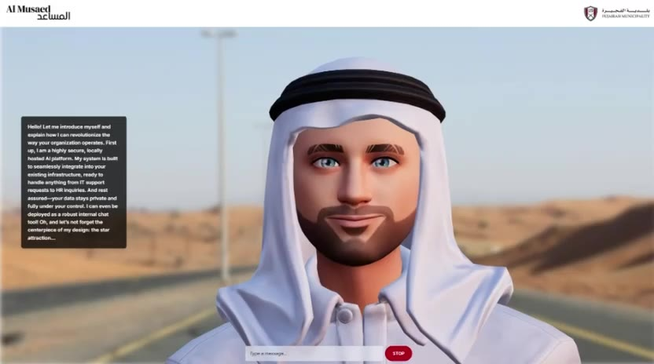
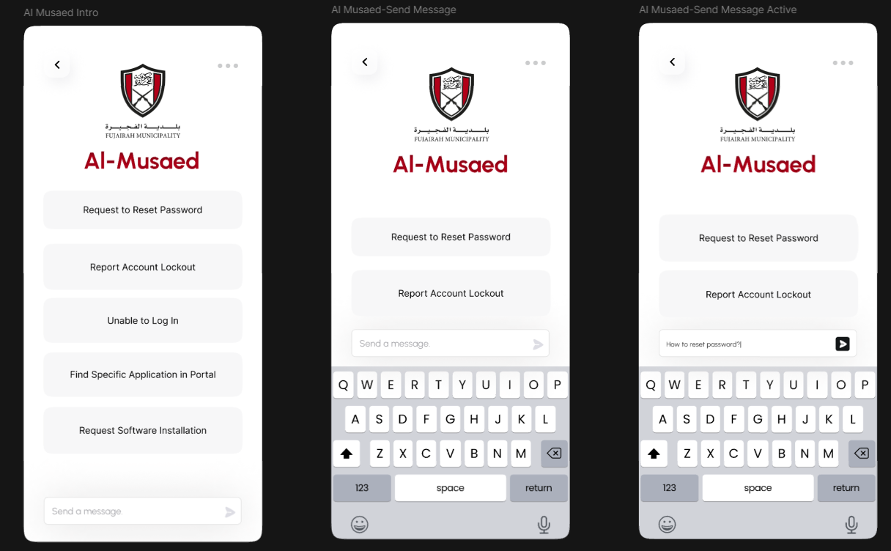

# Al Musaed

An AI assistant built for Fujairah Municipality as a university capstone project. It answers questions from the organisation's own documents and runs entirely on local hardware, with three ways to use it: a text chatbot, a voice assistant, and a 3D avatar that speaks its answers.

Built by a team of five students at the University of Wollongong in Dubai, summer 2024, with Fujairah Municipality's Smart Services Division. Shown at **GITEX Global Dubai 2024**, where it placed in the **top 2% of university innovations**.

<!-- Demo video: edit this file on GitHub and drag al-musaed-demo.mp4 onto this line. GitHub turns it into a video player. -->

The code isn't public: it was a university project built with a government partner. This page describes what it did and what I built.

## What it did

- **Answers from the organisation's own documents.** Questions are matched by meaning (semantic search), the most relevant passages are retrieved, and the language model answers from those passages rather than from general knowledge. The demo was set up for internal IT support requests, such as password resets and account lockouts.
- **Runs locally.** The language model, retrieval and speech all run on the organisation's own machines, so no data goes to an outside AI service. For a government client, that was the main requirement.
- **Three ways to use it.** A chat interface, a voice assistant, and a 3D avatar with lip-synced speech and facial expressions.
- **Several languages,** including Arabic and English.

## My part

I worked mostly on **the 3D avatar and the backend**, and on parts of the frontend:

- The 3D avatar: getting it to speak the assistant's answers with matching lip movement and expressions.
- The backend that connects the pieces: taking a question (typed or spoken), running retrieval over the documents, getting the answer from the local model, and sending it back as text and speech.
- Parts of the web frontend.

## How it worked

1. The municipality's documents were split into passages, turned into embeddings, and indexed (FAISS and ChromaDB).
2. A question, typed or transcribed from speech, was used to find the most relevant passages.
3. A locally hosted language model wrote an answer from those passages only.
4. The answer was shown as text, spoken aloud, and played through the avatar.

## Where it ended up

It wasn't deployed on the municipality's servers: running the language model locally needed GPU hardware they didn't have at the time. It stayed a working demo, presented at GITEX.

That taught me something I still use: "run it locally" and "run it cheaply on existing hardware" pull in opposite directions, and the hosting decision has to be made at the start, not after the system is built.

## What I'd do differently now

- Measure answer accuracy on a fixed set of test questions, instead of judging answers by eye.
- Show which document each answer came from, so people can check it.
- Plan the hosting first: either budget for the hardware, or design for a cloud model under a proper data agreement.

## Team

Taha Shabbir Hussain, Ali Akbar Abedi, Mohamad Dahhan, Syed Osaid Gilani, Saim Shaikh.

Advised by Abdul Latif Yusufzai (Head of Smart Services, Fujairah Municipality) and Dr George Tsaramirsis (University of Wollongong in Dubai).
